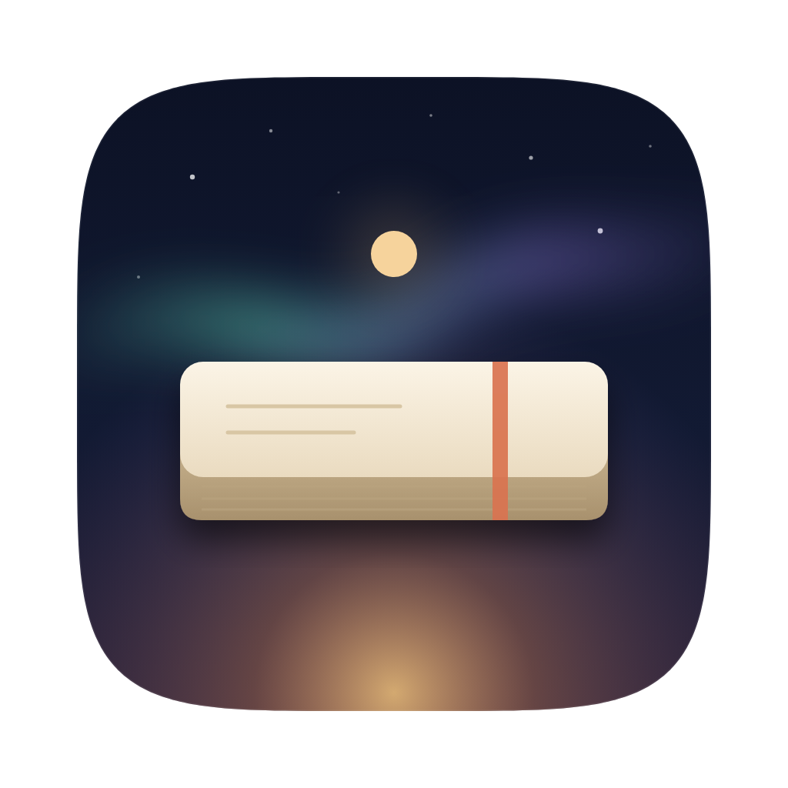

<p align="center"></p>

# analog_brick

**Put the laptop down. Pick up the pen.**

Analog Brick turns your Mac into a brick for a set amount of time so you can do notebook work without it.
Every display fills with a calm, slowly moving visual. Notifications go quiet. The only thing you can
touch is Spotify. Unlocking early takes your PIN three times, and you're asked whether you're sure after each one.

## How a session works

1. **Set it up.** Choose a duration (25, 45, 60, 90, 120 min or custom), an optional intention ("Chapter 3
   outline"), a visual, and a 4–8 digit PIN. Tip: have someone else type the PIN.
2. **Begin.** Every display is covered, the Dock and menu bar disappear, other apps are hidden, ⌘⇥, Mission Control
   and Force Quit are disabled, and Do Not Disturb turns on.
3. **Music.** A small player gives you play/pause, skip, volume, shuffle and your quick playlists. "Open Spotify"
   shows the real Spotify window for 90 seconds, then the brick comes back.
4. **Unlocking early.** PIN → "Are you sure?" → PIN → "Still sure?" → PIN → "Last ask." The "I'm sure" button
   waits a few seconds every time. Five wrong PINs in a row start a cooldown.
5. **Done.** At zero the visual fades, a short "Session complete" appears, and your desktop comes back exactly as it
   was.

If you restart the Mac mid-session, the brick comes back at login until the time is up.

## Visuals

| | |
|---|---|
| **Aurora** | Northern-lights curtains over a quiet starry sky |
| **Drift** | Thousands of silk threads following a slow flow field |
| **Breath** | A glowing orb that paces box / coherent / 4-7-8 breathing, in sync on every display |
| **Horizon** | A painterly mountain lake through a slow dusk-to-night-to-dawn cycle |
| **Night** | A slowly turning sky, the Milky Way, the odd shooting star |
| **Pulse** | Moves with your Spotify music, tinted by the album art |
| **Gallery** | Your own photo folder, drifting slowly |

You can switch visuals during a session.

## Install

Requirements: macOS 13 Ventura or later, plus Xcode or the Command Line Tools (`xcode-select --install`).

```bash
git clone https://github.com/saifiz2/make_me_analog.git
```

```bash
cd make_me_analog && scripts/build_app.sh
```

```bash
cp -R "build/Analog Brick.app" /Applications/ && open "/Applications/Analog Brick.app"
```

The build is ad-hoc signed. If macOS refuses to open a copy you downloaded (for example the CI artifact), clear
the quarantine flag:

```bash
xattr -dr com.apple.quarantine "/Applications/Analog Brick.app"
```

## One-time setup (the checklist in the app walks you through it)

**Do Not Disturb.** macOS has no public API for Focus, so Analog Brick runs two Shortcuts that you create once in
the Shortcuts app:

| Shortcut name (exactly) | Action |
|---|---|
| `Analog Brick Focus On` | **Set Focus** → Do Not Disturb → **Turn On** … **Until Turned Off** |
| `Analog Brick Focus Off` | **Set Focus** → Do Not Disturb → **Turn Off** |

You can pick a different Focus (e.g. a "Deep Work" one) in those shortcuts. Use **Test** in the app to check them.

**Spotify control.** Click **Allow** in the checklist while Spotify is open, then accept the macOS prompt.
This is only ever requested from the setup screen, never mid-session.

**Music-reactive visuals (optional).** Pulse listens to Spotify's audio output via ScreenCaptureKit. macOS
calls this *Screen Recording*. Only Spotify's audio is analysed; nothing is recorded or saved. Without the
permission, Pulse falls back to a gentle synthetic rhythm.

**Resume after restart.** On by default. The app registers a small login agent. If macOS says it needs approval,
use the button in the checklist (System Settings → General → Login Items).

> Rebuilding an ad-hoc signed app changes its signature, so macOS may ask for the Spotify and Screen Recording
> permissions again.

## The escape hatch

This is a commitment device, not a prison. If you really must get out (for example you forgot the PIN), hold the
power button to shut down, then hold ⇧ Shift while logging in, which skips login items. You can also delete
`~/Library/Application Support/Analog Brick/session.json`.

## Development

```
Sources/BrickCore/      pure Swift logic: unlock ritual, PIN hashing, settings, stats, FFT, palette (tested on macOS + Linux)
Sources/AnalogBrick/    AppKit shell: lock windows, kiosk, watchdog, Spotify, audio capture, Focus, login agent
web/                    every screen and visual (HTML/CSS/JS + WebGL), loaded by WKWebView via brick://
web/js/mock/            fake native side so pages run in any browser
docs/BRIDGE.md          the native ↔ web message contract
docs/PLAN.md            architecture, how the lock holds, decisions and limitations
tools/                  static server, screenshot tool, web smoke tests
```

```bash
swift test
```

```bash
node tools/serve.mjs
```

The second command serves `web/` for a browser. Open `/setup.html`, `/lock.html?minutes=25` or `/preview.html?mode=aurora&hud=1`.
`lock.html` takes mock parameters such as `role=secondary`, `spotify=paused`, `stage=pin`, `audio=1` and
`ending=completed`.

```bash
node tools/snap.mjs --url "preview.html?mode=horizon" --out shots/horizon.png
```

To point the app at your working copy of `web/` instead of the bundled one:

```bash
ANALOG_BRICK_WEB_ROOT="$PWD/web" ANALOG_BRICK_DEBUG=1 "build/Analog Brick.app/Contents/MacOS/AnalogBrick"
```

`ANALOG_BRICK_DEBUG=1` also enables the Web Inspector (Safari → Develop).

## License

MIT
